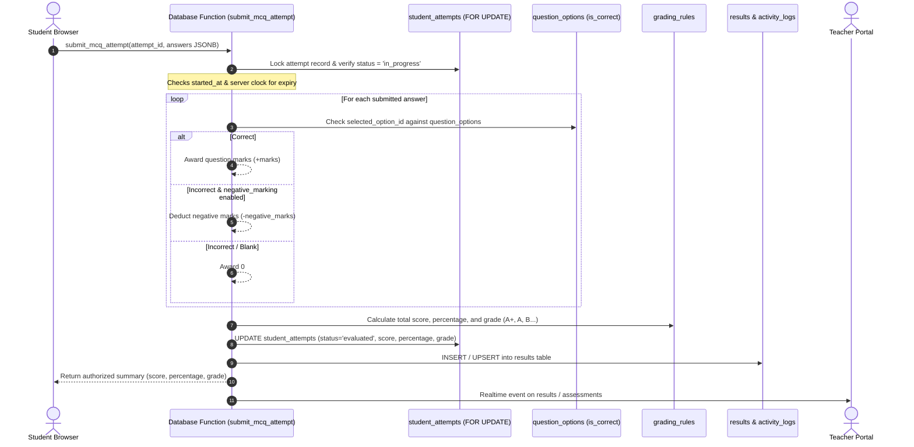

# Assessment & Auto-Grading Flow - Dudex Smart Academy

## Transactional Server-Side MCQ Grading

MCQ Assessment grading is **100% server-side and transactional**. The student browser never grades itself, never transmits score values, and never has access to the protected `is_correct` field.

---

## Grading Algorithm Guarantees
1. **Concurrency Lock**: `FOR UPDATE` on `student_attempts` blocks double submissions and race conditions.
2. **Authoritative Expiry**: Evaluation validates database timestamp against `expires_at`.
3. **Negative Marking Support**: Configurable per-assessment negative marking penalty.
4. **Grading Rules**: Grade assignment resolves dynamically against `grading_rules` (e.g. >=90% A+, 80–89% A, 70–79% B+, 60–69% B, 50–59% C, 40–49% D, <40% F).
