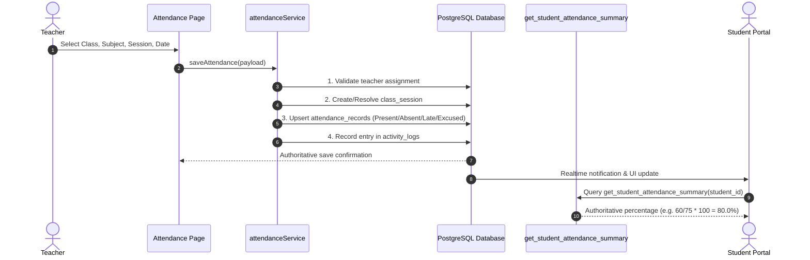

# Attendance Architecture & Calculation Flow - Dudex Smart Academy

## Official Attendance Workflow

Attendance records represent official institutional academic records. The frontend collects and displays attendance, while PostgreSQL validates teacher assignments, stores timestamps, audits changes, and calculates aggregate metrics.

---

## Authoritative Database Calculation Functions

### 1. `get_student_attendance_summary(p_student_id UUID)`
Returns:
- `total_sessions`: Total class sessions conducted for student's classes.
- `present_count`: Count of sessions marked `present`.
- `absent_count`: Count of sessions marked `absent`.
- `late_count`: Count of sessions marked `late` (weighted as 0.5 present).
- `excused_count`: Count of sessions marked `excused`.
- `percentage`: Exact database-computed attendance percentage.

### 2. `get_class_attendance_summary(p_class_id UUID)`
Returns:
- `total_sessions`
- `enrolled_students`
- `average_percentage`
