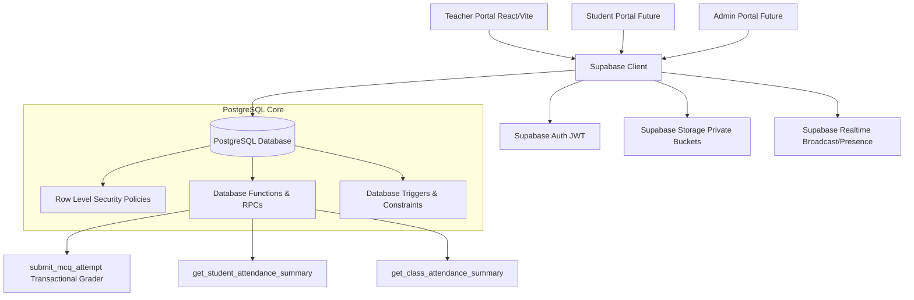

# Backend Architecture - Dudex Smart Academy

## System Overview
The backend for the Dudex Smart Academy platform is built on **Supabase** (PostgreSQL 15+, Supabase Auth, Row Level Security, Supabase Storage, Supabase Realtime, and Database Functions). 

The backend is engineered as a **single, centralized backend** designed to concurrently power:
1. **Teacher Portal**
2. **Student Portal**
3. **Admin Portal**

---

## Key Design Principles

1. **Backend as the Academic Authority**:
   - The browser / client is NEVER trusted for official scores, percentages, grades, attendance calculations, or role assignments.
   - All critical calculations (e.g. MCQ grading, negative marking, grade assignments, attendance percentages) are executed directly in Postgres via Database Functions (RPCs) and Views.

2. **Unified Schema, Scoped Authorization**:
   - Entities (`profiles`, `classes`, `students`, `teachers`, `attendance_records`, `notes`, `assessments`, `results`) are centralized and shared across all portals.
   - Row Level Security (RLS) ensures that teachers only see and mutate data for their assigned classes, students only see their own records, and admins have system-wide privileges.

3. **Stateless Authentication with RLS Propagation**:
   - Supabase Auth issues JWTs containing `sub` (User ID).
   - PostgreSQL helper functions (`public.has_role()`, `public.teacher_has_class()`, `public.current_teacher_id()`) inspect `auth.uid()` to enforce permissions without frontend leakage.

4. **Zero Client Secret Keys**:
   - Only `VITE_SUPABASE_URL` and `VITE_SUPABASE_PUBLISHABLE_KEY` (Anon key) are included in client bundles.
   - `service_role` keys are strictly forbidden in client-side code.
