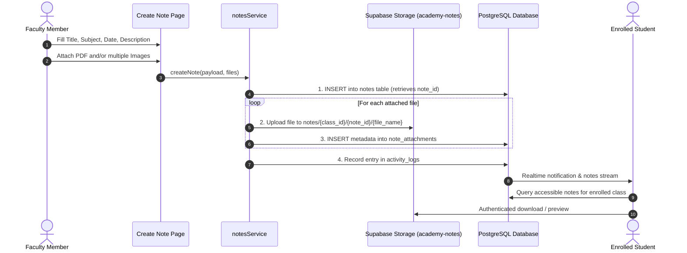

# Daily Notes Flow - Dudex Smart Academy

## Daily Notes with Multiple Uploads & Storage Workflow

The academy allows multiple independent notes to be created on the same day (e.g. Lecture Notes, Interview Questions, Practice Problems).

---

## Multiple Notes on the Same Date
The `notes` table enforces no single-note-per-day limitation. Each note is an autonomous row with its own UUID, attachments, timestamps, and publication status.

## Archiving / Soft Delete
Notes can be archived by updating `archived_at = now()`. The student portal filters out records where `archived_at IS NOT NULL`, while preserving complete historical audit trails.
