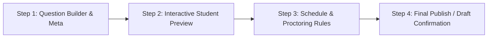

# Dudex Teacher Portal — Comprehensive System Architecture, Page Directory & Form Specifications

---

## 1. System Overview & Architecture

The **Dudex Teacher Portal** is an enterprise-grade academic operating system and faculty portal designed for higher education institutions, engineering colleges, and universities. It equips educators with a unified environment for syllabus delivery, student monitoring, automated attendance tracking, multi-tier assessments (Multiple Choice and Coding Challenges), proctoring, live virtual classrooms, and academic intervention workflows.

### High-Level Workflow Diagram

```mermaid
flowchart TD
    A[Faculty Login & Auth] --> B[Faculty Dashboard]
    
    subgraph Class & Student Management
        B --> C[Classes Hub]
        C --> C1[Create / Edit Class Section]
        C --> C2[Class Details & Student Roster]
        B --> D[Student Directory]
        D --> D1[Student Profile & Academic Dossier]
    end

    subgraph Attendance Operations
        B --> E[Student Attendance]
        E --> E1[Mark Daily / Period Attendance & Save]
        B --> F[Faculty Self-Attendance & Leaves]
        F --> F1[Punch Record & Advance Leave Request]
    end

    subgraph Assessments & Evaluation
        B --> G[MCQ Assessments Hub]
        G --> G1[4-Step MCQ Creation Wizard]
        G --> G2[MCQ Analytics & Submissions]
        B --> H[Coding Assessments & HackerRank]
        H --> H1[Create Coding Assessment]
        H --> H2[Coding Evaluation & Code Playback]
        H --> H3[Results & Gradebook]
    end

    subgraph Content & Digital Classroom
        B --> I[Study Materials & LMS Repository]
        B --> J[Live Virtual Classes]
        B --> K[Announcements & Broadcasts]
        B --> L[Student Communication & Helpdesk]
        B --> M[Faculty Lesson Notes]
        B --> N[Academic Calendar & Reports Exporter]
    end
```

---

## 2. Comprehensive Directory of Pages & Detailed Specifications

---

### Module 1: Authentication & Landing

#### 1. Home / Landing Page
- **Route:** `/` and `/home`
- **File:** `src/pages/Home.tsx`
- **Format & Layout:**
  - Modern institutional landing interface with brand hero typography, action CTA buttons, and interactive feature tiles.
- **Detailed Contents:**
  - **Hero Section:** Portal title, welcome tagline, and primary button `Go to Faculty Dashboard` / `Sign In`.
  - **Feature Showcase Grid:**
    - *MCQ & Coding Assessments:* Automated evaluation, plagiarism detection, and leaderboards.
    - *Live Virtual Classes:* Calendar scheduling and secure video conferencing integration.
    - *Attendance & Leave Management:* Real-time student tracking and 90-day faculty self-attendance ledger.
    - *Analytics & At-Risk Alerts:* Early warning alerts for students needing academic assistance.
  - **Institutional Statistics Banner:** Quick metrics highlighting courses, student count, and assessment completion rates.

#### 2. Faculty Authentication (Login)
- **Route:** `/login`
- **File:** `src/pages/auth/Login.tsx`
- **Format & Layout:**
  - Secure, centered login card with campus visual branding, input validation, and password visibility toggles.
- **Fields & Interactive Controls:**
  - `Email Address / Faculty ID`: Text/email input field (Required).
  - `Password`: Masked password input field with reveal toggle (Required).
  - `Remember Me`: Checkbox toggle for persistent session state.
  - `Forgot Password`: Support link for password reset.
  - `Sign In Button`: Primary submission CTA.
  - `Demo Fast-Fill`: Quick credentials pre-fill for development testing.

---

### Module 2: Faculty Dashboard

#### 3. Faculty Command Center Dashboard
- **Route:** `/dashboard`
- **File:** `src/pages/dashboard/Dashboard.tsx`
- **Format & Layout:**
  - Multi-column responsive dashboard featuring metric cards, schedule timelines, pending tasks, and action triggers.
- **Detailed Contents & Widgets:**
  - **Header Ribbon:** Live institutional date (e.g. *Friday, 11 September 2026*), personalized teacher greeting, quick link to `/calendar`, and shortcut to `/live-classes`.
  - **Teacher Info Card:** Faculty name, Department (e.g. *Computer Science and Engineering*), Employee Designation (*Associate Professor*), Faculty ID, and Access Status badge (*Authorized Faculty*).
  - **Faculty Self-Attendance Quick Widget:** Today's punch-in status indicator, rolling 90-day attendance percentage, and direct link to the comprehensive attendance ledger.
  - **Today's Lecture Schedule:** Chronological timeline cards displaying class time, subject code, room number/virtual link, and batch tag.
  - **Upcoming Assessments Card:** Highlights upcoming MCQ and coding tests, assigned student count, and scheduled dates.
  - **Recent Announcements Widget:** Latest departmental circulars and administrative alerts with priority badges.
  - **Pending Attendance Alerts:** Direct visual indicators for classes where today's attendance has not yet been submitted.

---

### Module 3: Class & Student Management

#### 4. Classes Hub (Directory)
- **Route:** `/classes`
- **File:** `src/pages/classes/Classes.tsx`
- **Format & Layout:**
  - Filterable card grid and tabular view with search input, batch dropdown, and `+ Create New Class` action button.
- **Detailed Contents:**
  - Grid of assigned classes displaying Class Name, Subject, Batch (e.g. *2024-2028*), Enrolled Students count, Daily Timetable, and Status badge (*Active / Archived*).
  - Quick action buttons on each card: `View Details`, `Edit Class`, and `Mark Attendance`.

#### 5. Create Class Page
- **Route:** `/classes/create`
- **File:** `src/pages/classes/CreateClass.tsx`
- **Format & Layout:**
  - Dedicated full-page creation form with breadcrumb navigation and input sanitization.
- **Detailed Form Fields & Specifications:**
  - `Class Name / Title`: String input (e.g., *Advanced Machine Learning - Section A*) [Required].
  - `Batches`: Custom Select dropdown (*All Batches, 2023-2027, 2024-2028, 2025-2029*) [Required].
  - `Subject`: Text input or linked subject dropdown [Required].
  - `Students Capacity / Count`: Numeric input (Default: `60`) [Required].
  - `Schedule Slot`: Time range text input (e.g., `10:00 AM - 11:00 AM`).
  - `Description / Syllabus Overview`: Multiline textarea for course syllabus summary and objectives.
- **Actions:** `Cancel` (returns to `/classes`), `Create Class` (persists class to local storage and updates state).

#### 6. Edit Class Page
- **Route:** `/classes/:id/edit`
- **File:** `src/pages/classes/EditClass.tsx`
- **Format & Layout:**
  - Pre-filled modification form mirroring the creation attributes with `Save Changes` and `Delete Class` safeguards.

#### 7. Class Details & Roster
- **Route:** `/classes/:id`
- **File:** `src/pages/classes/ClassDetails.tsx`
- **Format & Layout:**
  - Overview panel containing class statistics, schedule, and complete student roster table.
- **Detailed Contents:**
  - Roster Table columns: RRN / Roll Number, Student Full Name, Institutional Email, Attendance %, Performance Status (*Excellent, Average, At Risk*), and Profile link.
  - Header actions: `Take Attendance`, `Create Assessment`, `Export Roster`.

#### 8. Universal Class Search
- **Route:** `/classes/search`
- **File:** `src/pages/classes/ClassSearch.tsx`
- **Contents:** Multi-parameter search filter across subject codes, academic years, sections, and room allocations.

#### 9. Students Directory
- **Route:** `/students`
- **File:** `src/pages/students/Students.tsx`
- **Format & Layout:**
  - Comprehensive searchable directory with filters for Department, Year/Batch, and Academic Standing.
- **Detailed Contents:**
  - Student cards/rows showing Avatar, Name, RRN, Assigned Class, Overall CGPA/Percentage, Attendance %, and action to open the student dossier.

#### 10. Student Profile & Academic Dossier
- **Route:** `/students/:id`
- **File:** `src/pages/students/StudentProfile.tsx`
- **Format & Layout:**
  - Tabbed 360-degree academic profile view.
- **Detailed Contents:**
  - **Header:** Profile photo, RRN, contact email, enrollment batch, and academic advisor name.
  - **Attendance Tab:** Monthly attendance breakdown, present vs. absent days, leave history.
  - **Assessment Performance Tab:** MCQ test scores, test completion dates, percentile ranking.
  - **Coding Submissions Tab:** Solved challenges, languages used, test case pass rate, and execution times.
  - **Teacher Notes & Remarks:** Internal faculty notes and mentoring observations.

---

### Module 4: Attendance Management

#### 11. Student Attendance Management
- **Route:** `/attendance`
- **File:** `src/pages/attendance/Attendance.tsx`
- **Format & Layout:**
  - Real-time attendance ledger with class selector, subject selector, date picker, search bar, and bulk action toolbar.
- **Workflow & Interactive Form Controls:**
  - **Bulk Action Buttons:** `Mark All Present`, `Mark All Absent`, `Reset Form`.
  - **Individual Student Row Controls:**
    - `Status`: Dual-toggle buttons (`Present` [Green] / `Absent` [Red]).
    - `Check-In Timestamp`: Auto-records current timestamp when marked present (editable).
    - `Remarks`: Text input field for specific excuses, late arrivals, or medical notes.
  - **Submission Action:** `Save Attendance` (validates entries, locks the record, updates aggregate attendance metrics, and synchronizes to the gradebook).

#### 12. Faculty Self-Attendance & Leave System
- **Route:** `/my-attendance`
- **File:** `src/pages/attendance/TeacherAttendance.tsx`
- **Format & Layout:**
  - Advanced dual-pane ledger featuring attendance analytics, advance leave application modal, and chronological punch history.
- **Detailed Contents & Features:**
  - **90-Day Analytics Banner:** Overall Attendance %, Total Present Days, Absent Days, Approved Leaves, and Holidays.
  - **Advance Leave Application Modal:**
    - `Leave Date`: Date picker (Strict business rule: Only future dates permitted; past/today are blocked).
    - `Leave Type`: Dropdown selection (*Casual Leave, Medical Leave, Duty Leave, Special On-Duty*).
    - `Reason for Leave`: Multi-line text explanation (Required).
    - `Submit Leave Request`: Action button saving leave to the institutional ledger.
  - **Punch In / Punch Out Card:** Displays today's entry time, exit time, total working duration, and current status (*Present / Holiday / On Leave*).
  - **Attendance History Table:** Searchable table with month filter, status filter, displaying Date, Day of Week, Status, Check-In, Check-Out, Duration, and Remarks/Leave Reason.

---

### Module 5: Assessment Hub (MCQ & Coding)

#### 13. MCQ Assessments Hub
- **Route:** `/mcq-assessments`
- **File:** `src/pages/mcq-assessments/MCQAssessments.tsx`
- **Format & Layout:**
  - Tabbed assessment list categorized by Status (*Draft, Scheduled, Live, Completed*) with search and `+ Create MCQ Assessment` button.
- **Detailed Contents:**
  - Cards displaying Assessment Title, Subject Code, Target Class, Number of Questions, Total Marks, Duration, Scheduled Window, and Average Score.
  - Action menu: `View Analytics`, `Preview Test`, `Edit`, `Duplicate`, `Export Results`.

#### 14. Create MCQ Assessment (4-Step Wizard)
- **Route:** `/mcq-assessments/create`
- **File:** `src/pages/mcq-assessments/CreateMCQAssessment.tsx`
- **Format & Layout:**
  - Multi-step guided wizard with step progress tracker (Step 1: Questions & Metadata, Step 2: Preview, Step 3: Schedule, Step 4: Publish).

- **Detailed Step-by-Step Field Specifications:**
  - **Step 1: Metadata & Question Builder**
    - `Assessment Title`: Text string (e.g., *Data Structures Mid-Term MCQ Assessment*) [Required].
    - `Target Class`: Select dropdown populated from authorized faculty assignments [Required].
    - `Subject`: Auto-populated or selectable subject code [Required].
    - `Assessment Description / Instructions`: Rich textarea for test instructions.
    - **Dynamic Question Builder (Add/Delete/Reorder Questions):**
      - `Question Text`: Markdown/Text string for the question prompt.
      - `Options A, B, C, D`: 4 individual text inputs with radio button selector to designate the `Correct Answer Option`.
      - `Marks for Question`: Number input (Default: `1`).
      - `Explanation / Solution Reference`: Textarea explaining the correct rationale.
  - **Step 2: Interactive Student Preview**
    - Live mock preview rendering the exam interface exactly as a student sees it, allowing faculty to test choices.
  - **Step 3: Scheduling & Proctoring Configuration**
    - `Assessment Date`: Date picker input.
    - `Start Time` & `End Time`: Time range inputs.
    - `Duration (Minutes)`: Duration integer (e.g. `30`, `60`, `90` mins).
    - `Timezone`: Institutional timezone dropdown (*Asia/Kolkata (IST)*).
    - `Shuffle Questions`: Toggle switch to randomize question order for students.
    - `Shuffle Options`: Toggle switch to randomize option positions.
  - **Step 4: Final Publish & Confirmation**
    - Summary card with total questions, total marks, scheduled window, and buttons: `Save as Draft` or `Publish Assessment`.

#### 15. MCQ Assessment Details & Analytics
- **Route:** `/mcq-assessments/:id`
- **File:** `src/pages/mcq-assessments/MCQAssessmentDetails.tsx`
- **Detailed Contents:**
  - Statistical summary: High Score, Lowest Score, Median Score, Pass Percentage.
  - Question-level difficulty breakdown: Percentage of students answering each question correctly.
  - Student Submissions Ledger: RRN, Student Name, Marks Scored, Submission Timestamp, Time Taken, and Result Status (*Passed / Failed*).

#### 16. Coding Assessments Hub
- **Route:** `/coding`
- **File:** `src/pages/coding/Coding.tsx`
- **Detailed Contents:**
  - List of coding problems and challenges created by faculty.
  - Badges for Difficulty (*Easy / Medium / Hard*), Allowed Languages (*Python, Java, C++, JavaScript*), Total Submissions, and Success Rate.
  - Header button: `+ Create Coding Assessment`.

#### 17. Create Coding Assessment Page
- **Route:** `/coding/create`
- **File:** `src/pages/coding/CreateCodingAssessment.tsx`
- **Format & Layout:**
  - Full-featured technical problem creation form with dynamic test case repeaters.
- **Detailed Form Fields & Specifications:**
  - `Problem Title`: Text input (e.g. *Two Sum - Array Search Optimization*) [Required].
  - `Difficulty Level`: Dropdown (*Easy, Medium, Hard*).
  - `Problem Statement / Narrative`: Multi-line rich description of the algorithmic problem.
  - `Input Format`: Explicit explanation of standard input (`stdin`).
  - `Output Format`: Explicit explanation of standard output (`stdout`).
  - `Constraints`: Text input defining limits (e.g. $1 \le N \le 10^5$, $-10^9 \le A[i] \le 10^9$).
  - `Examples & Explanation`: Sample input, sample output, and explanation walk-through.
  - `Marks Weightage`: Numeric input (Default: `10`).
  - `Execution Limits`: `Time Limit (Seconds)` [e.g. `2s`] and `Memory Limit (MB)` [e.g. `256MB`].
  - `Allowed Programming Languages`: Checkbox selectors (*Python, Java, C, C++, JavaScript*).
  - `Schedule Window`: Start timestamp and End timestamp inputs.
  - **Visible Test Cases Repeater (Sample Cases):**
    - `Input Data`: Multi-line text for sample `stdin`.
    - `Expected Output`: Multi-line text for sample `stdout`.
  - **Hidden Test Cases Repeater (Grading Cases):**
    - `Input Data`: Secret test case input.
    - `Expected Output`: Secret test case expected output.
- **Form Actions:** `Cancel`, `Save Coding Assessment`.

#### 18. HackerRank Assessments Integration Hub
- **Route:** `/hackerrank`
- **File:** `src/pages/hackerrank/HackerRankAssessments.tsx`
- **Detailed Contents:**
  - Synchronized external challenges from the HackerRank enterprise ecosystem, leaderboard sync status, and automated test suite verification.

#### 19. Coding Evaluation & Code Playback
- **Route:** `/coding/:id`
- **File:** `src/pages/coding/CodingEvaluation.tsx`
- **Detailed Contents:**
  - **Code Editor / Viewer:** Full syntax-highlighted code submission from student.
  - **Test Case Execution Matrix:** Per-test-case status (Passed, Failed, Time Limit Exceeded, Memory Limit Exceeded).
  - **Metrics Panel:** Runtime in milliseconds, memory consumption in MB, and plagiarism similarity index.
  - **Faculty Grading Panel:** Manual marks override and constructive feedback input box.

#### 20. Coding Results & Leaderboard
- **Route:** `/coding/:id/results`
- **File:** `src/pages/coding/CodingResults.tsx`
- **Detailed Contents:**
  - Global and class-specific leaderboard ranking students by Test Cases Passed, Execution Efficiency, Marks, and Submission Time.

---

### Module 6: Results, Performance & Early Warning

#### 21. Consolidated Results Hub
- **Route:** `/results`
- **File:** `src/pages/results/Results.tsx`
- **Detailed Contents:**
  - Master gradebook aggregating MCQ assessment scores, coding problem points, and continuous internal evaluations.
  - Filterable by Class, Subject, and Academic Term with CSV/Excel export shortcuts.

#### 22. Individual Student Result Dossier
- **Route:** `/results/:id`
- **File:** `src/pages/results/IndividualResult.tsx`
- **Detailed Contents:**
  - Comprehensive student score breakdown, subject-wise GPA, radar chart mapping technical competencies, and printable official student transcript.

#### 23. Class Performance Analytics
- **Route:** `/performance`
- **File:** `src/pages/performance/Performance.tsx`
- **Detailed Contents:**
  - Bell curve distribution of scores, average class attendance vs. academic performance correlation chart, top percentile performers, and subject topic mastery metrics.

#### 24. At-Risk Students Early Intervention Hub
- **Route:** `/performance/at-risk`
- **File:** `src/pages/performance/AtRiskStudents.tsx`
- **Detailed Contents:**
  - Automated detection filter showing students with $<75\%$ attendance or $<50\%$ test scores.
  - Direct intervention action triggers: `Schedule 1-on-1 Mentoring`, `Send Academic Warning`, `Assign Remedial Module`.

---

### Module 7: Study Materials, Live Classes & Announcements

#### 25. Study Materials Hub & Create Material
- **Routes:** `/materials`, `/materials/create`, `/materials/:id`, `/materials/:id/edit`
- **Files:** `src/pages/materials/Materials.tsx`, `src/pages/materials/CreateMaterial.tsx`
- **Create Form Fields & Details:**
  - `Title`: Document or lecture title [Required].
  - `Class & Subject`: Dynamic select dropdown linked to authorized faculty assignments [Required].
  - `Material Type`: Select dropdown (*PDF, Video, Document, Presentation, Link, Assignment*) [Required].
  - `URL / External Resource`: Optional cloud link (e.g. Google Drive, GitHub repository).
  - `File Upload Area`: Drag-and-drop file uploader supporting `.pdf, .pptx, .docx, .mp4, .zip`.
  - `Description`: Summary notes and reading guidelines for students.
- **Form Actions:** `Cancel`, `Upload & Publish Material`.

#### 26. Announcements Hub & Create Announcement
- **Routes:** `/announcements`, `/announcements/create`, `/announcements/:id`, `/announcements/:id/edit`
- **Files:** `src/pages/announcements/Announcements.tsx`, `src/pages/announcements/CreateAnnouncement.tsx`
- **Create Form Fields & Details:**
  - `Announcement Title`: Headline string [Required].
  - `Target Class`: Select dropdown (*All Assigned Classes* or a specific section).
  - `Subject`: Associated subject code.
  - `Priority Level`: Radio/Select (*Low, Normal, High*) — High displays a critical alert banner.
  - `Publish Date`: Date selector (Default: Current date).
  - `Expiry Date`: Optional expiration date after which the announcement archives.
  - `Announcement Content`: Full rich text announcement body.
- **Form Actions:** `Cancel`, `Broadcast Announcement`.

#### 27. Live Virtual Classes Hub & Create Live Class
- **Routes:** `/live-classes`, `/live-classes/create`, `/live-classes/:id`, `/live-classes/:id/edit`
- **Files:** `src/pages/live-classes/LiveClasses.tsx`, `src/pages/live-classes/CreateLiveClass.tsx`
- **Create Form Fields & Details:**
  - `Session Title`: Name of the live class (e.g., *Dynamic Programming & Graph Algorithms Live Q&A*) [Required].
  - `Class & Subject`: Authorized class selection [Required].
  - `Session Date`: Scheduled session date [Required].
  - `Start Time` & `End Time`: Time pickers (Form validates that `End Time > Start Time`) [Required].
  - `Meeting Link`: URL input for video conference (Zoom, Google Meet, Microsoft Teams) [Required].
  - `Description / Agenda`: Topics to be covered and pre-class requirements.
- **Form Actions:** `Cancel`, `Schedule Live Class` (adds event to calendar and student dashboards).

#### 28. Student Communication & Helpdesk
- **Routes:** `/communication`, `/communication/create`, `/communication/:id`, `/communication/:id/edit`
- **Files:** `src/pages/communication/StudentCommunication.tsx`, `src/pages/communication/CreateCommunication.tsx`
- **Create Form Fields & Details:**
  - `Communication Type`: Select (*Announcements, Support Requests, Class Discussion, Teacher Notes*).
  - `Title / Subject`: Heading of discussion thread [Required].
  - `Class & Subject`: Target class scope [Required].
  - `Specific Student`: Optional student selector for private 1-on-1 faculty guidance.
  - `Priority`: Dropdown (*Low, Normal, High*).
  - `Message Body`: Text message content.
- **Form Actions:** `Cancel`, `Send Communication`.

#### 29. Faculty Notes & Lesson Plans
- **Routes:** `/notes`, `/notes/create`, `/notes/:id`, `/notes/:id/edit`
- **Files:** `src/pages/notes/Notes.tsx`, `src/pages/notes/CreateNote.tsx`
- **Create Form Fields & Details:**
  - `Note Date`: Date input for lecture delivery.
  - `Title`: Note title / Topic heading [Required].
  - `Class & Subject`: Linked academic section.
  - `Attachments`: File uploader for whiteboard snapshots, slide decks, or lesson outlines.
  - `Lesson Plan & Description`: Detailed instructional notes and homework reminders.
- **Form Actions:** `Cancel`, `Save Note`.

---

### Module 8: Utilities, System & Profile

#### 30. Academic Calendar
- **Route:** `/calendar`
- **File:** `src/pages/calendar/Calendar.tsx`
- **Format:** Month / Week / Day interactive calendar displaying scheduled lectures, live video sessions, assessment due dates, and official college holidays.

#### 31. Data Exports & Reporting Center
- **Route:** `/exports`
- **File:** `src/pages/exports/Exports.tsx`
- **Format:** Institutional export utility providing one-click downloads of CSV, Excel, and PDF reports for student attendance records, term gradebooks, and performance summaries.

#### 32. Faculty Profile & Settings
- **Route:** `/profile`
- **File:** `src/pages/profile/Profile.tsx`
- **Format:** Faculty personal dossier, departmental credentials, assigned subjects list, contact phone/email, and password reset panel.

#### 33. System Notifications & Alerts
- **Route:** `/notifications`
- **File:** `src/pages/notifications/Notifications.tsx`
- **Format:** Chronological notification center displaying real-time alerts for student test submissions, urgent student support requests, attendance deadlines, and administrative circulars.

---

## 3. Master Form Fields & Creation Matrix

| Creation Page | Primary Input Fields Required | Target Workflow & Output |
| :--- | :--- | :--- |
| **Create Class** (`/classes/create`) | Class Name, Batch, Subject, Capacity Count, Schedule, Description | Creates class card in `/classes`, sets up roster, and enables attendance/grading |
| **Create MCQ Assessment** (`/mcq-assessments/create`) | Title, Description, Class/Subject, Dynamic Questions (A/B/C/D + Correct Key + Marks + Solution Note), Schedule Date, Start/End Time, Duration, Shuffling Toggles | Publishes live/scheduled exam in `/mcq-assessments` and pushes to student portal |
| **Create Coding Assessment** (`/coding/create`) | Problem Title, Difficulty, Problem Narrative, Input/Output Format, Constraints, Languages, Marks, Limits, Sample & Hidden Test Cases | Deploys interactive programming challenge in `/coding` and links to evaluation engine |
| **Create Live Class** (`/live-classes/create`) | Title, Class, Subject, Date, Start & End Time, Video Meeting URL, Description | Schedules virtual class in `/live-classes` and registers event in `/calendar` |
| **Create Study Material** (`/materials/create`) | Title, Class, Subject, Material Type (PDF/Video/Doc/Link), File Attachments, External URL, Description | Publishes digital learning asset to `/materials` for class-wide student download |
| **Create Announcement** (`/announcements/create`) | Title, Class, Subject, Priority (Low/Normal/High), Publish Date, Expiry Date, Content | Broadcasts banner in `/announcements` and displays notice on teacher & student dashboards |
| **Create Communication** (`/communication/create`) | Type, Title, Class, Subject, Optional Student, Priority, Message Body | Opens discussion or support thread in `/communication` |
| **Create Faculty Note** (`/notes/create`) | Note Date, Title, Class, Subject, File Attachments, Lesson Content | Saves lesson plan in `/notes` for faculty review and semester archiving |
| **Apply Advance Leave** (`/my-attendance`) | Leave Date (strictly future date), Leave Type (Casual/Medical/Duty/On-Duty), Detailed Reason | Records leave request in `/my-attendance` and updates institutional 90-day ledger |
